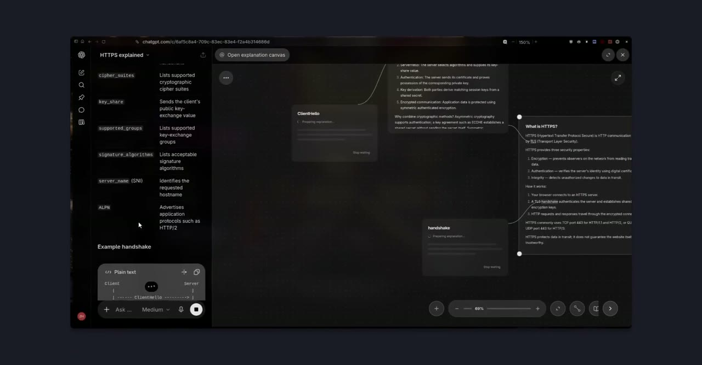

# Infinity Explainer

**Follow your curiosity. Keep the context.**

An infinite canvas for exploring ideas with AI. Expand a term or selected passage
into a connected explanation card, follow the concepts inside it, and keep your
reading path visible.

[](https://github.com/zylen-det/Infinity-Explainer-public/blob/main/assets/demo.mp4)

[Watch the demo video](https://github.com/zylen-det/Infinity-Explainer-public/blob/main/assets/demo.mp4).

## Run locally

Requires **Node.js 24+** and npm.

```sh
npm ci
npm run dev
```

The development server listens on localhost by default. To expose it on all
IPv4 network interfaces (`0.0.0.0`), run
`npm run dev -- --host 0.0.0.0`. The shorthand `npm run dev -- --host` listens
on all available network interfaces, including IPv6 where supported.

Open <http://localhost:5173>. In Settings, enter an OpenAI-compatible model
endpoint, model name, and API key if required. A local model server can keep
inference on your machine. The app sends requests directly from your browser;
the endpoint must allow requests from the app's origin. Include `/v1` in the base
URL when required; the app appends `/chat/completions`.
For llama.cpp, use a client address such as `http://127.0.0.1:8001/v1`
(`0.0.0.0` is a server bind address). The maximum generation budget defaults to
8192 tokens and can be changed in Settings to fit your model/server limits.
Reasoning and answer tokens share this budget; the app leaves thinking enabled
according to the server configuration and displays only answer content.
Empty answers and token-limit truncation report an error so you can increase
the budget and retry.

Settings, including any API key, are saved in browser local storage on this
origin. Selected passages and available parent context go to your configured
model endpoint. Canvas contents, positions, and viewport are also saved locally;
export and import JSON files for backup or transfer.

## Explore and read

- Expand a term or selected text into a connected explanation.
- Arrange, resize, edit, and connect cards as your exploration grows.
- Read Markdown and mathematical notation, focus on a card, and navigate its parents.
- Preserve your canvas between visits and export it as JSON.

## Integrate with an agent

This repository contains the reusable UI, canvas operations, file storage, and
MCP tools. The model can write its own answers with `write_block`; the tools do
not call another model service.

```sh
npm run setup:mcp
npm run build
npm run start:mcp
```

The local server listens on `127.0.0.1:8787`, serves the standalone UI at `/`, and
exposes the tools at `/mcp`. It has no account authentication and is intended for
personal local use. Canvas snapshots written through MCP are stored separately
under `.data/canvases`; the standalone UI currently uses browser local storage.
They are **not automatically synchronized**.

The HTTP server accepts only `localhost`, `127.0.0.1`, or `[::1]` Host headers.
Browser MCP requests must independently have a loopback HTTP(S) Origin;
non-browser clients may omit Origin. Changing the listen address with `HOST`
does not disable these checks or authorize another hostname.

For an integration that controls the UI, implement the `CanvasHost` contract in
[`src/services/CanvasHost.ts`](src/services/CanvasHost.ts) and call
`configureCanvasHost` before mounting the app. The shared UI then delegates
generation and persistence to that adapter instead of using the local provider.
See [integration boundaries](docs/integration.md).

A one-command agent launcher and browser-to-agent follow-up transport are not
included yet. This release provides the shared UI and tool foundation for them.

## Develop

- `src/`: React UI, D3 canvas, reading, editing, and optional host interface.
- `shared/`: canvas and layout contracts.
- `server/`: generic MCP tools, operations, and local file storage.
- `tests/`: reading and browser checks.

```sh
npm ci
npm run setup:mcp
npm run lint
npm test
npm run check:mcp
npm run build
npm run check:public
```

For browser tests, install Chromium with `npx playwright install chromium` or set
`CHROMIUM_PATH`, then run `npm run test:ui`. pnpm users should retain the supplied
lockfile and overrides; server dependencies are installed separately.

This public repository includes no hosted service deployment, authentication
implementation, or private platform adapter. It runs independently of them.

## Contribute

Include reproduction steps with bug reports and describe validation with changes.
Do not attach API keys or personal canvas data. Keep reusable behavior in this
repository; platform-specific authentication, hosting, and conversation bridges
belong in their integration repositories.

## License

[MIT](LICENCE). Third-party packages retain their respective licenses.

[Third-party licenses and notices](public/THIRD_PARTY_LICENSES.txt) include the
full license texts and font terms. This file is copied into builds; preserve it
when distributing the app and update it when dependencies change.
See the [notice reconciliation inventory](docs/license-updates.md) for the added
package versions, license text sources, and update procedure.
